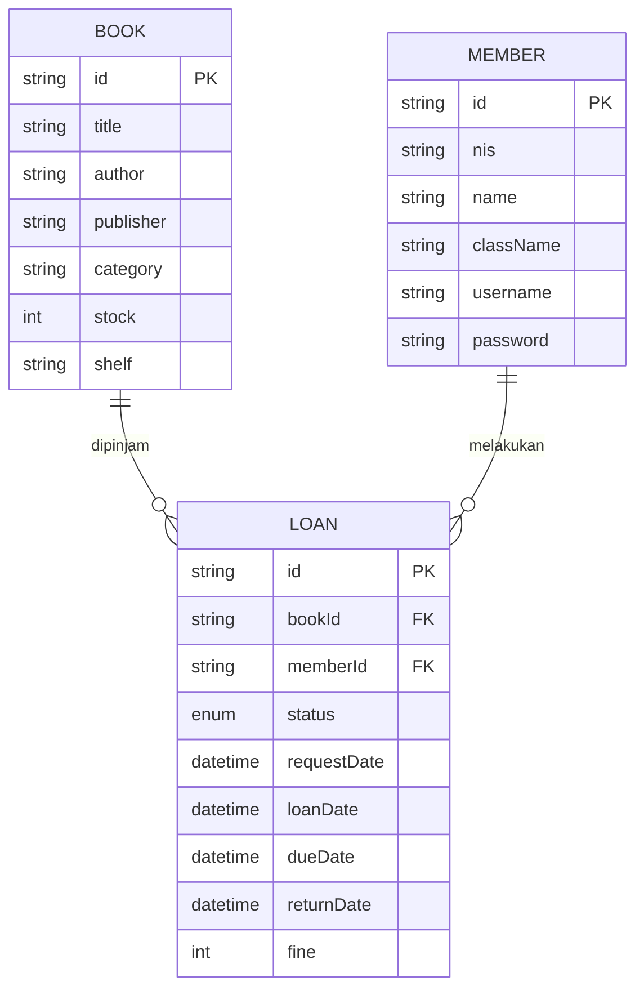
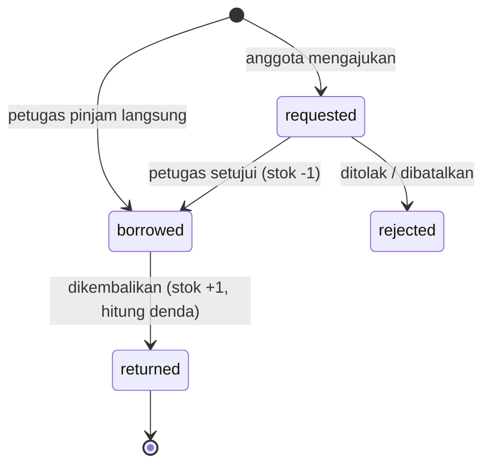

# Dokumentasi Perancangan & Uji Coba — Aplikasi Peminjaman Buku

## 1. Aturan Bisnis
| Aturan | Nilai |
|---|---|
| Lama pinjam | 7 hari |
| Denda keterlambatan | Rp 1.000 / hari |
| Maks. buku aktif per anggota | 3 (diajukan + dipinjam) |
| Pengingat | muncul bila jatuh tempo ≤ 2 hari atau terlambat |

## 2. Hak Akses
| Fitur | Petugas | Anggota |
|---|:-:|:-:|
| Kelola buku | ✔ | |
| Kelola anggota | ✔ | |
| Setujui/tolak pengajuan, pinjam langsung, kembalikan + denda | ✔ | |
| Laporan rekap & buku terfavorit | ✔ | |
| Cari & filter katalog | | ✔ |
| Ajukan / batalkan peminjaman | | ✔ |
| Pengingat jatuh tempo & riwayat | | ✔ |

## 3. Struktur Data (ERD)

Data disimpan sebagai array/list di memori (`List<Book>`, `List<Member>`, `List<Loan>`)
dan dipersistenkan ke file `perpustakaan.json` (akses file, `lib/services/storage.dart`).

## 4. Diagram Status Peminjaman


## 5. Algoritma Denda
```
hariTerlambat = max(0, tanggal(kembali) - tanggal(jatuhTempo))
denda         = hariTerlambat x 1000
```

## 6. Struktur Proyek
```
lib/
  main.dart                  titik masuk & pemilihan layar per hak akses
  models/                    Book, Member, Loan (+ toJson/fromJson)
  services/storage.dart      Storage (file JSON / memori)
  services/library_repository.dart  logika bisnis, FineCalculator, laporan
  screens/                   login, staff/*, member/*
  utils/                     format tanggal/rupiah, helper UI
test/library_test.dart       unit test
```

## 7. Rencana & Data Uji (unit test)
Jalankan: `flutter test`

| No | Skenario | Data uji | Hasil diharapkan |
|---|---|---|---|
| 1 | Kembali tepat waktu | tempo 10/10, kembali 10/10 | denda 0 |
| 2 | Terlambat 3 hari | tempo 10/10, kembali 13/10 | denda Rp 3.000 |
| 3 | Login salah | admin / salah | ditolak |
| 4 | Alur pinjam→kembali | pinjam, kembali hari ke-10 | stok pulih, denda Rp 3.000 |
| 5 | Pinjam buku sama 2x | buku sama | ditolak |
| 6 | Melebihi batas 3 buku | 4 buku | pengajuan ke-4 ditolak |
| 7 | Stok 0 | stok = 0 | pengajuan ditolak |
| 8 | Pencarian/filter | "laskar", kategori Pelajaran | 1 dan 2 hasil |
| 9 | Hapus buku dipinjam | buku aktif | ditolak |
| 10 | Pengingat | sisa 2 hari | muncul 1 pengingat |
| 11 | Laporan | 3 pinjam, 1 kembali | total 3, kembali 1, top buku 2x |
| 12 | Persistensi | simpan lalu muat ulang | data tetap ada |

Tabel hasil uji manual (isi saat uji): login petugas ☐, tambah/ubah/hapus buku ☐,
tambah anggota ☐, pengajuan siswa → disetujui petugas ☐, pengembalian terlambat ☐,
laporan ☐, pengingat ☐.

## 8. Generate Dokumentasi Kode
Semua kelas/fungsi memakai komentar `///` (dartdoc). Hasil HTML: `dart doc .`
→ folder `doc/api/`.
